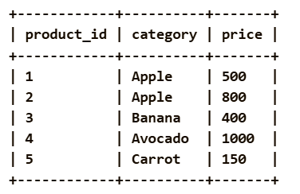
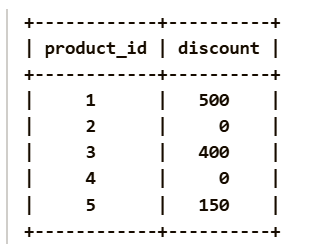

Given a DataFrame products containing information about products, determine the discount for each product. A product receives a discount equal to its price if product_id is even and category starts with 'A'; otherwise, the discount is 0.

Return a DataFrame containing the product_id and corresponding discount for each product, ordered by product_id in ascending order.

Pandas Schema:

product_id: The unique ID for each product (Primary key).

category: The category of the product.

price: The price of the product.

Example :
Input table:

Output table:

Explanation:

The result is a DataFrame having product_id and discount .

Product 1: The product_id is odd, so no discount is applied.

Product 2: The product_id is even, and the category starts with 'A' (Apple), so the discount is 100% of the price (800).

Product 3: The product_id is odd, so no discount is applied.

Product 4: The product_id is even, and the category starts with 'A' (Avocado), so the discount is 100% of the price (1000).

Product 5: The product_id is odd, so no discount is applied.