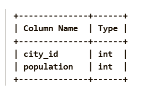
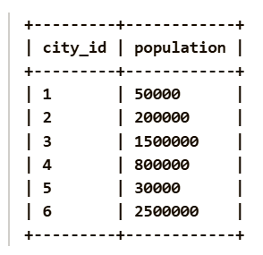
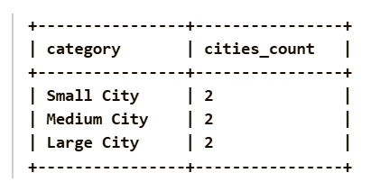

Given a DataFrame cities containing information about cities and their populations, determine the number of cities that belong to each population category. The population categories are defined as follows:

Small City: Population strictly less than 100000.
Medium City: Population in the inclusive range [100000, 1000000].
Large City: Population strictly greater than 1000000.
Return a DataFrame with the following columns:

category: The population category.
cities_count: The number of cities belonging to that category.
The result must always contain all three categories. If no city belongs to a category, return 0 for that category.

Pandas Schema:

city_id: Unique ID for each city (Primary key).

population: Population of the city.

Example :
Input table:

Output table:

Explanation: The result is a DataFrame with two columns: category and cities_count.

Small City contains cities with city_id 1 and 5, so the count is 2.
Medium City contains cities with city_id 2 and 4, so the count is 2.
Large City contains cities with city_id 3 and 6, so the count is 2.
Hence, the output shows the number of cities in each population category.