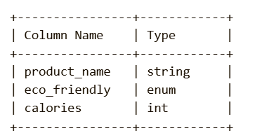
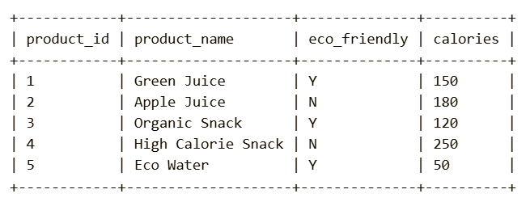
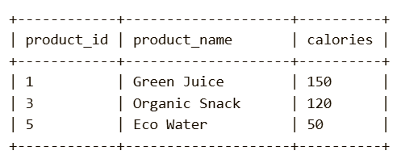

Problem Description:
Write a solution to find the product_id, product_name, and calories of all products that are eco-friendly and have low calories.

A product is considered eco-friendly if the eco_friendly field has a value of 'Y'.

A product is considered to have low calories if the calories are less than or equal to 200.

Return the result table in any order.

Pandas Schema:

product_id: Unique ID for each product (Primary key).

product_name: Name of the product.

eco_friendly: An enum indicating whether the product is eco-friendly ('Y' for Yes, 'N' for No).
calories: The number of calories in the product (integer value).

Task:
Write a solution to find the product_id, product_name, and calories of all products that are eco-friendly and have low calories.

Example :
Input table:

Output table:

Explanation:

Product 1 (Green Juice): It is eco-friendly and has 150 calories (which is low).

Product 3 (Organic Snack): It is eco-friendly and has 120 calories (which is low).

Product 5 (Eco Water): It is eco-friendly and has 50 calories (which is low).

Products 2 and 4: Either not eco-friendly or have more than 200 calories.

