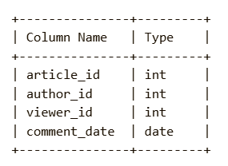
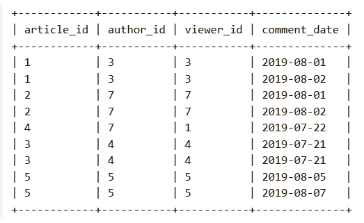
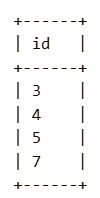

Given a DataFrame containing information about comments made on articles, where:
article_id represents the article.
author_id  represents the author of the article.
viewer_id represents the user who commented on the article.
comment_date represents the date of the comment.
Find all authors who have commented on their own articles more than once.
Return a DataFrame containing the author_id  of such authors, renamed as id, sorted in ascending order.

Pandas Schema:

article_id: Unique ID for each article.

author_id: The unique ID of the article's author.

viewer_id: The unique ID of the person who commented on the article.

comment_date: The date when the comment was made.

Example :
Input table:

Output table:

Explanation:
Author 3: Commented twice on their own article (article 1).

Author 7: Commented twice on their own article (article 2).

Author 5: Commented twice on their own article (article 5).