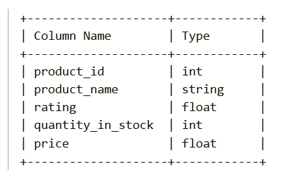
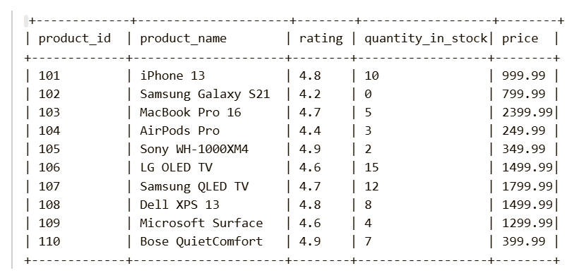
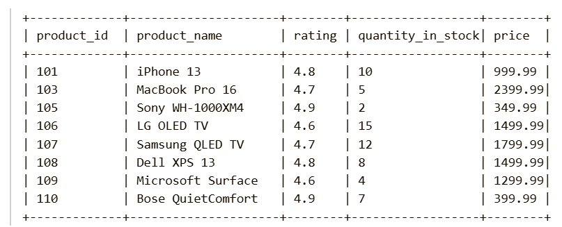

Given a Pandas DataFrame products containing information about products, return the product_id, product_name, rating, quantity_in_stock, and price of all products that are high-rated, in stock, and expensive. A product is considered high-rated and expensive if:

The product has a rating of at least 4.5.
The product is available in stock (quantity_in_stock > 0).
The product price is at least 300.

Return the resulting DataFrame in any order.

Pandas Schema:

product_id: Unique ID for each product (Primary key).

product_name: The name of the product.

rating: The rating of the product (float, ranging from 1 to 5).

quantity_in_stock: The number of units available in stock.

price: The price of the product.

Example :
Input table:

Expected Output :

