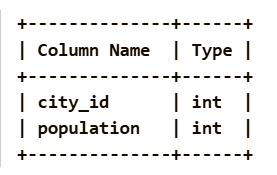
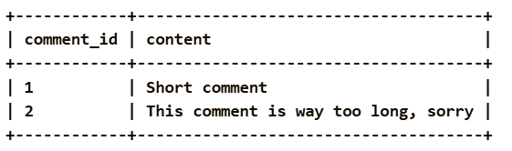
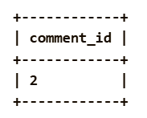

Problem Description:
Write a solution to find the IDs of the invalid comments. The comment is invalid if the number of characters used in the content of the comment is strictly greater than 20.

Pandas Schema:

comment_id: The unique ID of the comment (Primary key).

content: The content of the comment (contains alphanumeric characters, '!', and ' ' and no other special characters).

Task:
Write a solution to find the comment_id of all invalid comments. A comment is invalid if the content length is strictly greater than 20 characters.

Example :
Input table:

Output table:

Explanation:

Comment 1 has a length of 17 characters. It is a valid comment.

Comment 2 has a length of 38 characters. It is an invalid comment.