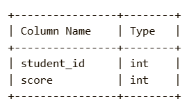
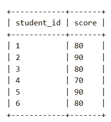
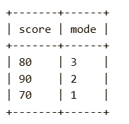

Problem Description:
You are given a table with the scores of students in a class. Your task is to find the most frequent score in the table.

The mode is the score that appears most frequently. If there are multiple scores with the same highest frequency, return all of them.

Return the result table ordered by score in ascending order.

SQL Schema:

student_id: Unique ID for each student.

score: The score that the student received in the exam.

Task:
Write a solution to find the mode of the scores, i.e., the score(s) that were most frequently received by students.

Example:
Input:

Output:

Explanation:

The result is a DataFrame having score and mode.

80 is the most frequent score, appearing 3 times.

90 is the second most frequent score, appearing 2 times.

Note: Please use the same variable names and format as shown in the output