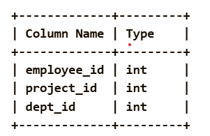
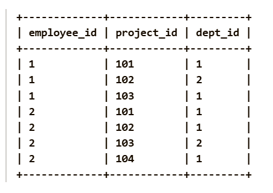
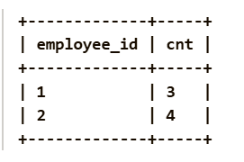

Given a DataFrame employee_projects containing information about employees and the projects they work on, determine the number of unique projects worked on by each employee. An employee may be associated with the same project multiple times. Count only the distinct project_id values for each employee.

Return a DataFrame containing the columns employee_id and cnt, where cnt is the number of distinct projects associated with the employee. The result can be returned in any order.

Pandas Schema:

employee_id: The unique ID for each employee.

project_id: The unique ID for each project.

dept_id: The department ID where the project belongs.

The combination of project_id and dept_id serves as a unique identifier for each project in a specific department.

Example :
Input table:

Output table:

Explanation: The result is a DataFrame having employee_id and cnt .

Employee 1: Works on project 101, 102, and 103 (3 unique projects).

Employee 2: Works on project 101, 102, 103, and 104 (4 unique projects).

