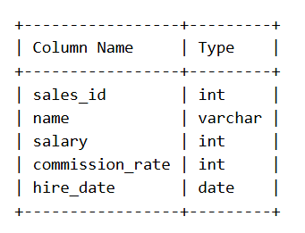
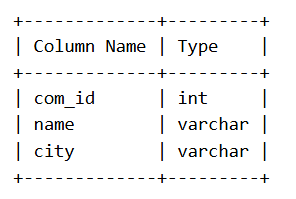
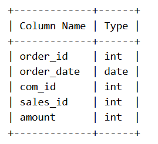
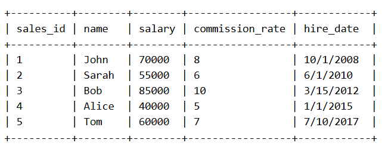
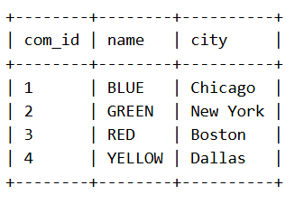
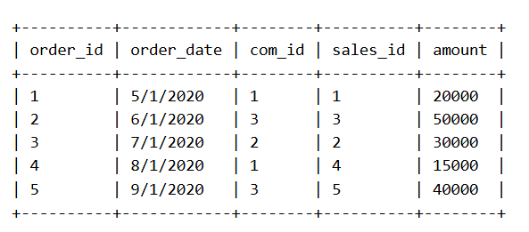
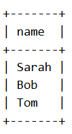

Problem Description:
Write a solution to find the names of all the salespersons who did not have any orders related to the company with the name "BLUE".

Return the result table in any order.

Pandas Schema:

Table: SalesPerson

sales_id: Unique ID for each salesperson (Primary key).

name: The name of the salesperson.

salary: The salary of the salesperson.

commission_rate: The commission rate of the salesperson.

hire_date: The hire date of the salesperson.

Table: Company

com_id: Unique ID for each company (Primary key).

name: The name of the company.

city: The city where the company is located.

Table: Orders

order_id: Unique ID for each order (Primary key).

com_id: Foreign key referring to the Company table.

sales_id: Foreign key referring to the SalesPerson table.

order_date: The date of the order.

amount: The amount of the order.

Task:
Write a solution to find the name of all salespeople who did not have any orders related to the company named "BLUE".

Return the result table with the name of the salesperson.

Example:
Input tables:

SalesPerson table:

Company table:

Orders table:

Output table:

Explanation:

Sarah , Bob and Tom did not have any sales related to BLUE, so they are included in the output.

