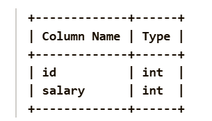
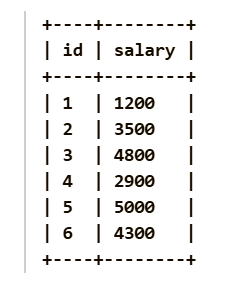
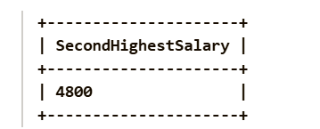

Given a Pandas DataFrame employee containing employee salary information, find the second highest distinct salary. Return the result as a DataFrame with a single column named SecondHighestSalary. If there is no second highest distinct salary, return None in that column.

Pandas Schema:

id: Unique ID for each employee (Primary key).

salary: The salary of the employee.

Example :
Input table:

Output table:

Explanation: The distinct salaries are 1200, 3500, 4800, 2900, 5000 and 4300. The second highest distinct salary is 4800.