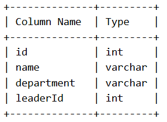
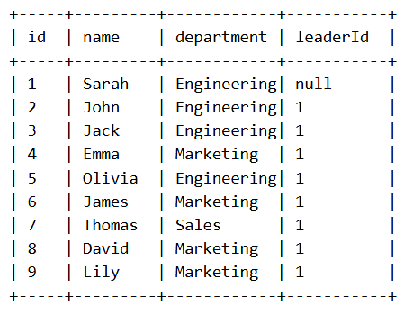
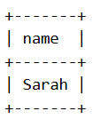

Given a DataFrame employee containing information about employees and their team leaders, find the names of all team leaders who have at least 4 direct reports. An employee is considered a direct report of a team leader if the employee's leaderId is equal to that team leader's id.

Return a DataFrame containing the names of all such team leaders.

Pandas Schema:

id: Unique ID for each employee (Primary key).

name: Name of the employee.

department: The department where the employee works.

leaderId: ID of the employee's team leader (null if the employee has no leader).

Example :
Input table:

Output table:

Explanation:

Sarah is the team leader of John, Jack, Emma, Olivia, James, Thomas, David, and Lily (8 direct reports).

Therefore, Sarah is included in the result.